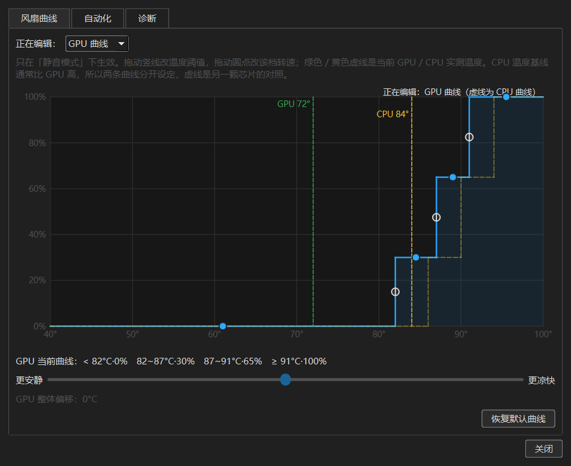
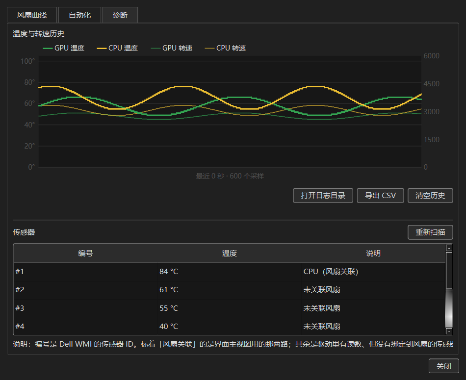

# Dell G15 散热控制中心 · 简体中文版

> 本项目是 [AlexIII/tcc-g15](https://github.com/AlexIII/tcc-g15) 的**简体中文本地化版本**。
> 界面文案已全部翻译为简体中文，并额外增加了「静音模式」。原作者版权归 AlexIII 所有，遵循 GPLv3。


## 直接下载

**[⬇ tcc-g15-zh-win64.zip](https://github.com/ybq9430/tcc-g15-zh/releases/latest)**（约 47MB，免安装）

解压到任意目录，双击 `tcc-g15.exe`，UAC 弹窗点「是」即可运行，无需安装 Python 或任何运行库。
这是从上游 v1.6.5 源码重新编译的版本，非替换文件。

## 这是什么

Dell G 系列 / Alienware 笔记本出厂自带的 AWCC（Alienware Command Center）体积臃肿、手动风扇控制失效、还会偷偷上传遥测数据。本项目是它的开源替代品，基于 Dell 的 WMI 散热控制接口实现。

能做的事：

- 在 **平衡模式 / 静音模式 / G 模式 / 自定义** 之间切换散热模式
- 实时显示 CPU / GPU 温度与风扇转速
- 半手动调节风扇转速
- 温度超过阈值时自动切到 G 模式（温度保护，阈值可调）
- 支持键盘 G 模式快捷键（可自定义按键）
- **可拖动的风扇曲线编辑器**，GPU 与 CPU 各一条独立曲线，带「安静 ↔ 凉快」整体偏移滑块
- **转速平滑渐变**：升速快（30%/秒）、降速慢（6%/秒），不会出现转速突变的「呼」声
- **电源联动**：电池供电自动切静音、插电回平衡
- **游戏检测**：检测到全屏游戏自动切 G 模式，退出后恢复
- **温度/转速历史曲线**，可导出 CSV
- **传感器总览**：列出所有有读数的传感器，包括没绑定到风扇的隐藏项
- **运行日志**：写入 `%LOCALAPPDATA%\TCC-G15\logs\app.log`，出问题时可直接查

## 设置面板（本版新增）

主界面右下角「设置…」按钮或托盘菜单都能打开，分三个页签。

### 风扇曲线



**GPU 和 CPU 各有一条独立曲线**，用下拉框切换正在编辑的那条，另一条以黄色虚线画在图上作为对照。
两条曲线分开设定是因为同一颗芯片的 CPU 温度基线通常比 GPU 高 6~10°C，
共用一条曲线会让 CPU 长期顶在最高档、把风扇一路拉满，静音效果直接被吃掉。

拖动竖线改温度阈值、拖动圆点改该档转速，绿色/黄色虚线是当前实测的 GPU / CPU 温度，
可以对着真实温度调。下方一根「更安静 ↔ 更凉快」滑块会把**当前这条曲线**的温度边界统一平移
（±8°C），不用逐档改。

曲线存在注册表（`HKCU\Software\github.com\AlexIII\tcc-g15\AWCC`），改完立即生效。
旧版本只有一条共用曲线，升级时会自动迁移给 GPU，CPU 回到默认值。

### 自动化

| 功能 | 行为 | 默认 |
| --- | --- | --- |
| 电源联动 | 用电池时切到指定模式，插电时切回平衡模式 | 关闭 |
| 游戏检测 | 前台全屏且进程不在排除表 → 切 G 模式；退出全屏 8 秒后恢复原模式 | 关闭 |
| 全局热键 | 点按钮后按下一个键即可改绑（字母/数字/F1~F24） | F17 |

**游戏检测是启发式的**：Dell 的接口不告诉我们当前跑的是什么程序，只能靠「窗口铺满屏幕
+ 进程名不在排除表」来猜。浏览器按 F11 全屏、视频播放器全屏都会被误判，
把进程名加进排除表即可。所以这个功能默认关闭。

手动切换模式会覆盖自动化：如果游戏运行时你手动换了个模式，退出游戏后就不会被改回去。

### 诊断



- 温度与转速历史曲线（环形缓冲，约 30 分钟），可导出 CSV
- 传感器总览。扫描结果里会显示全部有读数的传感器 ID —— 本机除 CPU/GPU 两路外，
  还有一路 `#3` 没有绑定到任何风扇，温度常年与 CPU 接近，推测是主板/供电区域。

## 静音模式

原版只有平衡 / G 模式 / 自定义三档，Dell 的 WMI 接口也没有暴露原生的「静音」档
（`Thermal_Control` 只认 `Custom=0`、`Balanced=0x97`、`G_Mode=0xAB`）。
所以静音模式是**软件实现**的：切到 Custom 让 EC 交出手动风扇控制权，再由程序按温度分档调速。

默认分档策略（可在「设置 → 风扇曲线」里拖动修改）：

| GPU 温度 | 风扇 | | CPU 温度 | 风扇 |
| --- | --- | --- | --- | --- |
| < 82°C | 最低速（0%） | | < 86°C | 最低速（0%） |
| 82~87°C | 30% | | 86~90°C | 30% |
| 87~91°C | 65% | | 90~94°C | 65% |
| ≥ 91°C | 100% | | ≥ 94°C | 100% |

配套的防抖规则：

- **升档立即响应**，温度一到位马上升速；**降档每次最多退一档**，避免转速骤降后又反弹
- **转速平滑渐变**：升速 30%/秒、降速 6%/秒。一次性从 30% 跳到 65% 会有明显的「呼」一声，
  渐变之后听感自然很多，同时 0→100% 仍能在 3 秒内走完，不会耽误散热
- **档位滞环 5°C**，必须跌出当前档位下界 5°C 才降档
- **降档冷静期 45 秒**，升档后 45 秒内不降档，避免风扇反复启停（可听见的"呼吸"）
- 每 25 秒重申一次当前转速，防止 EC 自行接管回自动曲线

温度保护仍然有效，超过阈值照样切 G 模式。

### 实测效果（Dell G3 3590，i5-9300H）

| 场景 | 平衡模式 | 静音模式 |
| --- | --- | --- |
| 空载（CPU 63°C） | 2607 / 2827 RPM | 2609 / 2819 RPM |
| 中等负载 | EC 曲线提前拉高 | 保持最低速直到 82°C |

**空载噪音与平衡模式相同**——因为手动控制的下限（0% ≈ 2600 RPM）已经到了硬件最低，
平衡模式下 EC 本来也在这个转速。静音模式的收益在于**中等负载时不急着提速**，
以及风扇转速变化更平缓，不会忽高忽低。

如果你想要空载更安静：这台机器做不到，EC 的自动曲线已经是最低点了。

## 汉化范围

| 位置 | 说明 |
| --- | --- |
| 窗口标题 / 关于框 | 全中文 |
| 散热模式选项 | 平衡模式 / 静音模式 / G 模式 / 自定义 |
| 温度保护 | 复选框、阈值提示、状态指示（正常 / 上次高温时间） |
| 风扇滑块 | 「风扇转速」标签 |
| 托盘菜单 | 散热模式、显示主界面、开机自启、恢复默认设置、退出 |
| 弹窗 | 退出确认、恢复默认、错误提示等 |
| 系统通知 | 散热模式切换提示 |
| Qt 系统按钮 | 通过 `qtbase_zh_CN.qm` 翻译包，确定 / 取消 等按钮也是中文 |

**有意保留英文的部分**：CPU / GPU 硬件型号名（如 `NVIDIA GeForce GTX 1650`）、`RPM` 单位、以及程序内部的配置键名。这些翻译后反而不易识别。

技术说明：散热模式的枚举值（`Balanced` / `G_Mode` / `Custom`）**没有改动**，因为后端按名字调用 WMI 接口、配置文件中保存的也是这些值。汉化通过额外的显示名映射层实现，不影响与后端的通信，也不会导致已有设置丢失。

## 支持的机型

原版作者收集到的兼容机型：

- Dell G15：5511、5515、5520、5525、5530、5535、5590
- Dell G3 3590、G3 15 3500
- Dell Alienware m16 R1、Alienware 16X Aurora、Alienware 18 Area-51 AA18250

其他 Dell G 系列 / Alienware 机型可能也能用。本汉化版在 **Dell G3 3590 + Windows 11** 上实测通过。

## 使用

程序需要**管理员权限**（访问 WMI 接口所必需），启动时会弹 UAC，点「是」即可。

已打包的版本：见 [Releases](../../releases)。下载后解压，右键 `tcc-g15.exe` → 以管理员身份运行。

## 从源码构建

环境：Windows 10/11、Python 3.13。

```bat
python -m pip install -r requirements.txt pyinstaller
build.bat
```

产物在 `dist\tcc-g15\`，整个目录一起拷走即可运行。

也可以直接跑源码：

```bat
cd src
python tcc-g15.py
```

## 版本记录

### v1.6.6-zh

在 v1.6.5-zh2 的基础上修了一批实际会撞上的问题：

| 问题 | 表现 | 修复 |
| --- | --- | --- |
| 静音模式污染自定义转速 | 静音模式每秒改写滑块，这个值被当成「自定义模式转速」存了下来。切回自定义时风扇变成曲线最后一次下发的值（可能是 0%） | 静音模式下改用 `_lastCustomSpeed` 快照保存 |
| 恢复默认设置不彻底 | `settings.clear()` 清了配置，但曲线、自动化、热键没重置也不刷新界面，下次保存又把旧值写回去 | 一起重置并通知设置窗口重新同步 |
| 设置窗口累积 | 每次点设置都新建一个对话框（父对象持有引用，关闭不销毁），而且每次都要重跑 1 秒的阻塞传感器扫描 | 复用单例，传感器扫描结果缓存 |
| WMI 偶发失败直接退程序 | 睡眠唤醒后首次调用 WMI 常返回失败，用户看到「切换到某模式失败，程序即将退出」 | 先重试一次，仍失败则回滚选中项并给托盘提示，不再退出 |
| 单实例保护失效 | 原实现的锁文件先删除再创建，两个实例都能启动成功，互相抢风扇控制权 | 改用共享内存判定 + 本地套接字唤出已运行窗口 |
| 电池联动启动不生效 | 首次读到的供电状态只记录不判定，开机就用电池时不会切模式 | 电池供电时启动即应用一次（插电时不动，避免覆盖手动选择） |
| 开机自启每次弹模态框 | 点一次菜单就弹一个「成功」对话框 | 改成托盘气泡 |
| 升级后无法排查 | 打包用了 `-w`，所有 `print` 全部丢失 | 统一写入 `%LOCALAPPDATA%\TCC-G15\logs\app.log`，1MB 轮转保留 3 份 |

另外：GPU / CPU 曲线拆分、转速平滑渐变、托盘菜单新增「查看温度历史…」直达入口、
诊断页新增「打开日志目录」按钮。

## 已知问题

以下均为原版就存在的问题，与汉化无关：

- 切换 G 模式时可能出现约 1 秒的全系统卡顿，这是 Dell 底层接口的固有行为，无法修复
- 手动风扇控制并非真正手动：转速设得过低时，温度到阈值 BIOS 会强行接管提速
- 「开机自启」依赖 Windows 任务计划程序，部分系统安全策略下可能失效
- 极少数情况下驱动会返回错误的 GPU 温度读数

遇到其他异常，先看 `%LOCALAPPDATA%\TCC-G15\logs\app.log`（诊断页有「打开日志目录」按钮），
里面记录了每次模式切换、风扇写入和未捕获的异常。

## 与上游同步

`zh-CN-translation.patch` 是相对上游源码的全部汉化改动，可直接查看或重新套用：

```bat
git clone https://github.com/AlexIII/tcc-g15.git
cd tcc-g15
git apply ../zh-CN-translation.patch
```

另外构建时额外加了一个数据目录 `src/GUI/translations/`（Qt 中文翻译包），这是补丁之外唯一的新增文件。

## 授权

本项目遵循 **GPL v3**，见 [LICENSE](LICENSE)。

- 原项目：<https://github.com/AlexIII/tcc-g15>（作者 AlexIII）
- 本仓库仅做简体中文本地化，不主张对原作品的著作权
- 按 GPLv3 要求，本衍生版本同样以 GPLv3 发布，并保留原作者署名

## 免责声明

本软件通过修改笔记本散热策略工作，**使用风险自负**。作者与本汉化者不对因使用本软件造成的硬件损坏、数据丢失或任何其他损失承担责任。若不确定是否兼容你的机型，请先备份重要数据。
