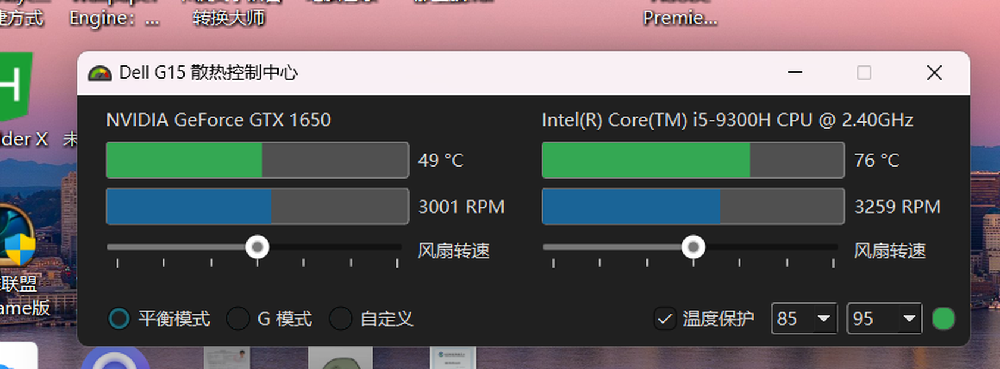

# Dell G15 散热控制中心 · 简体中文版

> 本项目是 [AlexIII/tcc-g15](https://github.com/AlexIII/tcc-g15) 的**简体中文本地化版本**。
> 软件功能与原版完全一致，仅将界面文案翻译为简体中文。原作者版权归 AlexIII 所有，遵循 GPLv3。



## 这是什么

Dell G 系列 / Alienware 笔记本出厂自带的 AWCC（Alienware Command Center）体积臃肿、手动风扇控制失效、还会偷偷上传遥测数据。本项目是它的开源替代品，基于 Dell 的 WMI 散热控制接口实现。

能做的事：

- 在 **G 模式 / 平衡模式 / 自定义** 之间切换散热模式
- 实时显示 CPU / GPU 温度与风扇转速
- 半手动调节风扇转速
- 温度超过阈值时自动切到 G 模式（温度保护）
- 支持键盘 G 模式快捷键

## 汉化范围

| 位置 | 说明 |
| --- | --- |
| 窗口标题 / 关于框 | 全中文 |
| 散热模式选项 | 平衡模式 / G 模式 / 自定义 |
| 温度保护 | 复选框、阈值提示、状态指示（正常 / 上次高温时间） |
| 风扇滑块 | 「风扇转速」标签 |
| 托盘菜单 | 散热模式、显示主界面、开机自启、恢复默认设置、退出 |
| 弹窗 | 退出确认、恢复默认、错误提示等 |
| 系统通知 | 散热模式切换提示 |
| Qt 系统按钮 | 通过 `qtbase_zh_CN.qm` 翻译包，确定 / 取消 等按钮也是中文 |

**有意保留英文的部分**：CPU / GPU 硬件型号名（如 `NVIDIA GeForce GTX 1650`）、`RPM` 单位、以及程序内部的配置键名。这些翻译后反而不易识别。

技术说明：散热模式的枚举值（`Balanced` / `G_Mode` / `Custom`）**没有改动**，因为后端按名字调用 WMI 接口、配置文件中保存的也是这些值。汉化通过额外的显示名映射层实现，不影响与后端的通信，也不会导致已有设置丢失。

## 支持的机型

原版作者收集到的兼容机型：

- Dell G15：5511、5515、5520、5525、5530、5535、5590
- Dell G3 3590、G3 15 3500
- Dell Alienware m16 R1、Alienware 16X Aurora、Alienware 18 Area-51 AA18250

其他 Dell G 系列 / Alienware 机型可能也能用。本汉化版在 **Dell G3 3590 + Windows 11** 上实测通过。

## 使用

程序需要**管理员权限**（访问 WMI 接口所必需），启动时会弹 UAC，点「是」即可。

已打包的版本：见 [Releases](../../releases)。下载后解压，右键 `tcc-g15.exe` → 以管理员身份运行。

## 从源码构建

环境：Windows 10/11、Python 3.13。

```bat
python -m pip install -r requirements.txt pyinstaller
build.bat
```

产物在 `dist\tcc-g15\`，整个目录一起拷走即可运行。

也可以直接跑源码：

```bat
cd src
python tcc-g15.py
```

## 已知问题

以下均为原版就存在的问题，与汉化无关：

- 切换 G 模式时可能出现约 1 秒的全系统卡顿，这是 Dell 底层接口的固有行为，无法修复
- 手动风扇控制并非真正手动：转速设得过低时，温度到阈值 BIOS 会强行接管提速
- 「开机自启」依赖 Windows 任务计划程序，部分系统安全策略下可能失效
- 极少数情况下驱动会返回错误的 GPU 温度读数

## 与上游同步

`zh-CN-translation.patch` 是相对上游源码的全部汉化改动，可直接查看或重新套用：

```bat
git clone https://github.com/AlexIII/tcc-g15.git
cd tcc-g15
git apply ../zh-CN-translation.patch
```

另外构建时额外加了一个数据目录 `src/GUI/translations/`（Qt 中文翻译包），这是补丁之外唯一的新增文件。

## 授权

本项目遵循 **GPL v3**，见 [LICENSE](LICENSE)。

- 原项目：<https://github.com/AlexIII/tcc-g15>（作者 AlexIII）
- 本仓库仅做简体中文本地化，不主张对原作品的著作权
- 按 GPLv3 要求，本衍生版本同样以 GPLv3 发布，并保留原作者署名

## 免责声明

本软件通过修改笔记本散热策略工作，**使用风险自负**。作者与本汉化者不对因使用本软件造成的硬件损坏、数据丢失或任何其他损失承担责任。若不确定是否兼容你的机型，请先备份重要数据。
